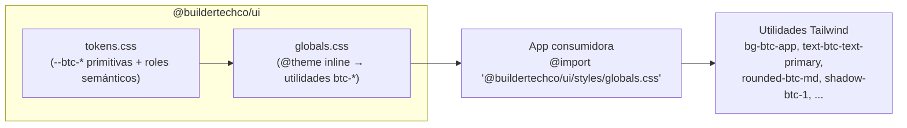

# @buildertechco/ui

> **Design System propietario de BuilderTech** — Tokens, componentes, utilidades, validación y documentación en un paquete versionado de forma independiente.

[](CHANGELOG.md)
[](https://nodejs.org/)
[](https://pnpm.io/)
[](https://react.dev/)
[](https://tailwindcss.com/)
[](https://storybook.js.org/)

> **Nota de estructura**: el paquete vive en la raíz del repositorio (single-package root). Ver [ADR-008](docs/adrs/008-reorganizacion-estructura-base.md) y [ADR-009](docs/adrs/009-storybook-validacion-visual.md).

---

## 🚀 Inicio Rápido

### Instalación desde GitHub Packages

El paquete se publica en el scope que corresponde al owner del repositorio (`BuilderTechCo`):

```bash
# Configurar credenciales del usuario (no guardar el token en el repositorio).
# NODE_AUTH_TOKEN debe contener un PAT con read:packages.
npm config set --location=user //npm.pkg.github.com/:_authToken "$NODE_AUTH_TOKEN"

# Instalar desde la raíz del monorepo.
pnpm --filter @buildertech/web add @buildertechco/ui@0.1.0
```

La raíz del monorepo configura `@buildertechco:registry=https://npm.pkg.github.com` en `.npmrc`; las credenciales se configuran a nivel de usuario porque pnpm 12 no expande variables de entorno para tokens en un `.npmrc` versionado. En GitHub Actions, configura `GITHUB_TOKEN` con permiso `packages: read` y proporciona el token al registry mediante un `.npmrc` temporal de usuario. El repositorio del paquete y el monorepo son repositorios Git separados; no se instala con `workspace:*`. Antes de instalar, confirma que la versión solicitada está publicada en GitHub Packages.

### Configuración CSS (Tailwind v4, CSS-first)

```css
/* app/globals.css */
@import "tailwindcss";
@import "@buildertechco/ui/styles/globals.css";

/* Necesario para que Tailwind detecte las clases usadas por el paquete
   publicado en node_modules. Ajusta la ruta respecto a este archivo. */
@source "../node_modules/@buildertechco/ui/dist";
```

No se necesita `tailwind.config.ts` para consumir el DS: los tokens se publican como variables CSS y se mapean a utilidades `btc-*` mediante `@theme inline`.

### Uso de componentes

```tsx
import { Button, Card, Icon } from "@buildertechco/ui";

export function MiComponente() {
  return (
    <Card variant="default" padding="md">
      <Card.Header>
        <Card.Title>Usuarios</Card.Title>
        <Card.Description>Lista de usuarios activos</Card.Description>
      </Card.Header>
      <Card.Content>
        <Button
          variant="primary"
          size="md"
          leftIcon="plus"
          leftIconCategory="action"
        >
          Nuevo usuario
        </Button>
      </Card.Content>
    </Card>
  );
}
```

`Card`, `Dialog` y `DropdownMenu` exponen sub-componentes estáticos (`Card.Header`, `Dialog.Footer`, `DropdownMenu.Item`). Los mismos sub-componentes también están disponibles como exports nombrados.

### Tipografías (Next.js `layout.tsx`)

```tsx
import { getFontSans, getFontMono } from "@buildertechco/ui/lib/fonts";

const sans = getFontSans();
const mono = getFontMono();

export default function RootLayout({ children }) {
  return (
    <html className={`${sans.variable} ${mono.variable}`}>
      <body>{children}</body>
    </html>
  );
}
```

`getFontSans()`, `getFontMono()` y `getFontDisplay()` devuelven `{ variable, className, style }`. Este subpath solo se usa en apps Next.js (`next >=14`); `next` es un peer opcional. Los helpers de fuente no se exportan desde el barrel raíz.

> **Consumo del paquete:** `pnpm test:consumer` construye con Vite/Tailwind v4 el barrel raíz, las 23 subrutas JavaScript no específicas de Next y ambas subrutas CSS. La importación ESM nativa de Node no está soportada: los imports relativos emitidos por TypeScript no llevan extensión y Node tampoco procesa CSS. La prueba Vite no valida una app Next.js ni el subpath específico `@buildertechco/ui/lib/fonts`.

---

## 📦 Qué Incluye

| Categoría                   | Detalle                                                                                                                                     |
| :-------------------------- | :------------------------------------------------------------------------------------------------------------------------------------------ |
| **Tokens de diseño**        | Variables CSS `--btc-*` (color, espaciado, radios, fuentes, sombras, movimiento, z-index) y roles semánticos light/dark                     |
| **23 componentes públicos** | 16 base + 7 primitivas: Toast, ToastProvider, ToastViewport, Label, Separator, Slot, DropdownMenu                                           |
| **Utilidades**              | `clsx` (clsx + tailwind-merge), `Icon` (wrapper semántico de Lucide), helpers de fuentes Next.js en subpath separado                        |
| **Validación**              | `check:design` — 12 reglas visuales + guardarraíl anti-lógica-de-negocio                                                                    |
| **Storybook**               | Catálogo de 21 stories, controles, acciones, viewports, backgrounds, tema, accesibilidad y component tests                                  |
| **Tests**                   | 334 tests unit/integration + 255 tests de stories (verificados el 2026-11-10) + 22 specs visuales Playwright, pendientes como deuda técnica |
| **Documentación**           | Arquitectura, APIs, tokens, gobernanza, ADRs, navegadores y changelog                                                                       |

### Componentes

| Grupo              | Componentes                                                                                                                                                    |
| :----------------- | :------------------------------------------------------------------------------------------------------------------------------------------------------------- |
| **Base (16)**      | Button, Card, Dialog, Select, Table, NavLink, Badge, TextField, EmptyState, LoadingState, ErrorState, ErrorPage, CopyButton, BackButton, ThemeToggle, Skeleton |
| **Primitivas (7)** | Toast, ToastProvider, ToastViewport, Label, Separator, Slot, DropdownMenu                                                                                      |

---

## 🛠 Comandos

Todos los comandos se ejecutan desde la raíz del repositorio.

| Comando                      | Descripción                                                       |
| :--------------------------- | :---------------------------------------------------------------- |
| `pnpm build`                 | Build a `dist/` (JS + `.d.ts` + CSS)                              |
| `pnpm build-storybook`       | Build estático de Storybook                                       |
| `pnpm check:component-files` | Verifica la estructura de archivos de componentes                 |
| `pnpm check:contract`        | Exports de `package.json` ↔ `src/` y todos los targets de `dist/` |
| `pnpm check:design`          | Reglas visuales + guardarraíl de lógica de negocio                |
| `pnpm check:suppressions`    | Comprueba supresiones de lint y TypeScript                        |
| `pnpm format`                | Aplica Prettier a los archivos del repositorio                    |
| `pnpm format:check`          | Comprueba el formato del repositorio sin modificar archivos       |
| `pnpm lint`                  | ESLint 9 flat config                                              |
| `pnpm quality:verify`        | `typecheck` + `lint` + `check:design` + `test`                    |
| `pnpm storybook`             | Storybook en `http://127.0.0.1:6006` (abre el navegador)          |
| `pnpm test`                  | Tests unit (Node) + integration (jsdom)                           |
| `pnpm test:consumer`         | Build temporal con Vite/Tailwind de exports JS y CSS              |
| `pnpm test:coverage`         | Cobertura de unit + integration                                   |
| `pnpm test:docs-contract`    | Verifica identidad, instalación y comandos del PR                 |
| `pnpm test:static`           | Typecheck + lint + contratos de exports/docs + component files    |
| `pnpm test:storybook`        | Tests de stories en Chromium con Vitest + Playwright              |
| `pnpm test:visual`           | Regresión visual Playwright (8 proyectos)                         |
| `pnpm typecheck`             | TypeScript estricto (`tsc --noEmit`)                              |

> `quality:verify` no incluye `test:storybook` ni `test:visual` porque requieren Chromium/Storybook. Ejecútalos por separado antes de un release.
>
> `prepublishOnly` incluye los checks de calidad, contratos de exports/docs, `build` y `test:consumer`; Storybook y Playwright permanecen fuera de ese gate.

Para aplicar Prettier solo a archivos concretos, usa `pnpm exec prettier --write <archivos>`.

---

## 🏗 Arquitectura

### Distribución por CSS



### Principios arquitectónicos

| Principio                            | Descripción                                                                          |
| :----------------------------------- | :----------------------------------------------------------------------------------- |
| **Fuente única de verdad**           | Tokens, componentes, validación y docs viven en este repositorio                     |
| **Distribución por CSS**             | El consumidor importa una sola línea de `globals.css`                                |
| **Cero dependencias de UI externas** | Dialog, Select, DropdownMenu, Toast, Label, Separator y Slot son nativos             |
| **Cero lógica de negocio**           | Componentes presentacionales: reciben props, renderizan UI y emiten eventos          |
| **Versionado independiente**         | `0.1.x` en desarrollo; `1.0.0` como objetivo de congelación de API                   |
| **Paquete publicado `dist`-only**    | `files: ["dist"]`; el repositorio sí incluye tests, e2e, Storybook y scripts         |
| **Testing en capas**                 | Unit (Node), integration (jsdom), stories (Chromium) y regresión visual (Playwright) |

### Estructura del repositorio

```text
btc-002-ui/
├── src/
│   ├── index.ts                  # Barrel público
│   ├── styles/
│   │   ├── tokens.css            # Variables CSS --btc-* y roles light/dark
│   │   └── globals.css           # @theme inline → utilidades btc-*
│   ├── components/               # 21 directorios, 23 componentes públicos
│   │   ├── button/
│   │   ├── card/
│   │   ├── dialog/
│   │   ├── select/
│   │   ├── table/
│   │   ├── textfield/
│   │   ├── toast/
│   │   └── ... (14 directorios más)
│   ├── lib/
│   │   ├── classnames/           # clsx + tailwind-merge
│   │   ├── icon/                 # Wrapper semántico de Lucide
│   │   └── fonts/                # Helpers next/font
│   └── test/
│       ├── setup.ts              # Integration (jsdom)
│       └── setup-unit.ts         # Unit (Node)
├── e2e/
│   ├── visual/                   # 22 specs; los 3285 snapshots locales no están versionados
│   └── support/                  # global setup/teardown y utilidades
├── scripts/
│   ├── check-design.ts           # 12 reglas + guardarraíl
│   ├── check-component-contract.ts
│   ├── check-component-files.mjs
│   ├── check-suppressions.mjs
│   └── register.mjs
├── .storybook/
│   ├── main.ts                   # Addons y framework
│   ├── preview.tsx               # Tema, viewports, backgrounds, decorador
│   ├── preview-head.html         # Layout full-width
│   └── vitest.setup.ts           # Setup de storybook test
├── docs/                         # ADRs, arquitectura, componentes, tokens, guías
├── vitest.config.ts              # Config base
├── vitest.workspace.ts           # Proyectos unit + integration + storybook
├── playwright.config.ts          # 8 proyectos visuales
├── tsconfig*.json
├── eslint.config.js
└── package.json
```

---

## 📚 Documentación

| Documento                                                             | Descripción                                                  |
| :-------------------------------------------------------------------- | :----------------------------------------------------------- |
| [Arquitectura](docs/arquitectura/indice.md)                           | Principios, estructura y convenciones                        |
| [Especificación de API](docs/tokens/especificacion-api.md)            | Props, variantes y accesibilidad de los 23 componentes       |
| [Guía de componentes](docs/componentes/guia.md)                       | Instalación y ejemplos de uso reales                         |
| [Paleta visual](docs/tokens/paleta-visual.md)                         | Colores, ratios de contraste reales y deuda de accesibilidad |
| [Layout & Sizing](docs/tokens/dimensiones-disposicion.md)             | Espaciado, elevación, z-index y delegación a Tailwind        |
| [Enforcement](docs/gobernanza/cumplimiento.md)                        | Reglas obligatorias, excepciones y sanciones                 |
| [ADRs](docs/adrs/indice.md)                                           | ADR-001 a ADR-009                                            |
| [Navegadores soportados](docs/componentes/navegadores-compatibles.md) | Matriz de compatibilidad y alcance de la validación          |
| [Contribuir](docs/guias/contribuir.md)                                | Flujo de PR, testing y release                               |
| [Añadir un componente](docs/componentes/agregar-componente.md)        | Proceso paso a paso                                          |
| [Migración](docs/guias/guia-migracion.md)                             | Guía para apps consumidoras                                  |
| [Changelog](CHANGELOG.md)                                             | Historial por versión                                        |
| [Clasificación de tests](CLASIFICACION.md)                            | Estado y decisiones sobre los tests                          |

---

## 🧪 Testing

### Unit + Integration (Vitest)

```bash
pnpm test
```

| Proyecto      | Entorno | Alcance                        | Setup                    |
| :------------ | :------ | :----------------------------- | :----------------------- |
| `unit`        | Node    | `src/lib/**/*.test.ts*`        | `src/test/setup-unit.ts` |
| `integration` | jsdom   | `src/components/**/*.test.tsx` | `src/test/setup.ts`      |

- **24 archivos de test**, **334 tests** (verificados dos veces el 2026-11-10; las 334 pruebas pasaron en ambas ejecuciones).
- Integration valida comportamiento con Testing Library: eventos, foco, teclado, ARIA y estado.
- Unit valida utilidades puras (classnames, iconos, tipos).

### Storybook

```bash
pnpm storybook
```

Abre automáticamente `http://127.0.0.1:6006`. Si el puerto está ocupado, detén la instancia previa.

| Herramienta            | Ubicación      | Uso                                                       |
| :--------------------- | :------------- | :-------------------------------------------------------- |
| **Controls / Actions** | Panel inferior | Props editables y callbacks registrados                   |
| **Viewport**           | Toolbar        | Mobile 360px, Tablet 768px, Laptop 1024px, Desktop 1440px |
| **Backgrounds**        | Toolbar        | `light`, `surface`, `raised`                              |
| **Theme**              | Toolbar        | Light / Dark (aplica `data-theme` en `<html>`)            |
| **Measure / Outline**  | Toolbar        | Medición de espaciado y contornos                         |
| **Accessibility**      | Panel inferior | Auditoría axe por story                                   |
| **Component tests**    | Panel inferior | Resultados de Vitest por story                            |
| **Run tests**          | Sidebar        | Ejecuta la suite de stories en el navegador               |

### Storybook component tests (Chromium)

```bash
pnpm exec playwright install chromium   # primera vez
pnpm test:storybook
```

Ejecuta las 21 stories en un navegador real con `@storybook/experimental-addon-test` y Vitest browser mode. En la validación del **2026-11-10** pasaron **255 tests en 21 archivos**.

### Regresión visual (Playwright)

```bash
pnpm test:visual
```

| Configuración      | Detalle                                                              |
| :----------------- | :------------------------------------------------------------------- |
| **Viewports**      | 360×800, 768×1024, 1024×1024, 1440×1024                              |
| **Temas**          | Light, Dark                                                          |
| **Proyectos**      | 8 (`light-*` / `dark-*`)                                             |
| **Specs**          | 22                                                                   |
| **Snapshots base** | 3285 PNGs locales; excluidos de Git y ausentes en un checkout limpio |
| **Umbral**         | `maxDiffPixels: 0`, `maxDiffPixelRatio: 0.001`, `threshold: 0.2`     |

El `webServer` de Playwright arranca Storybook automáticamente en local si no está corriendo. En CI requiere Storybook disponible o un servidor equivalente; por eso no forma parte de `quality:verify`.

**Deuda técnica abierta:** `pnpm test:visual` no se ejecutó en la validación del 2026-11-10. Los 3285 snapshots registrados existen solo localmente, no están versionados y no están disponibles en un checkout limpio; por ello la ejecución no es reproducible para todo el equipo. La deuda se considera resuelta cuando exista una fuente reproducible de baselines y la suite se valide en un checkout limpio.

---

## ✅ Validación `check:design`

```bash
pnpm check:design
```

Escanea `src/` por defecto. Para otros directorios, configura `checkDesign.scanDirs` en `package.json`; la CLI no acepta `--scan-dirs`.

### 12 reglas visuales + 1 guardarraíl

| ID                      | Regla                                                           |
| :---------------------- | :-------------------------------------------------------------- |
| `only-btc-color-tokens` | Solo tokens de color `btc-*`                                    |
| `only-btc-utilities`    | Solo utilidades `btc-*` para spacing, radius y shadow           |
| `spacing-scale`         | Escala de espaciado `0,1,2,3,4,6,8,12,16`                       |
| `sizing-scale`          | Sizing con escala definida o Tailwind estándar                  |
| `radius-defined`        | Solo radios definidos                                           |
| `font-system`           | Solo fuentes del sistema (`font-btc-*`)                         |
| `duration-standard`     | Solo duraciones `btc-*`                                         |
| `ease-standard`         | Solo `ease-btc-standard`                                        |
| `shadow-defined`        | Solo `shadow-btc-1..5`                                          |
| `z-index-controlled`    | Solo `z-btc-*`                                                  |
| `transition-allowed`    | Solo `transition-btc-*`                                         |
| `no-important`          | Sin `!important` (salvo utilities globales)                     |
| `no-business-logic`     | **Guardarraíl**: prohíbe `fetch`, `supabase`, `prisma`, `axios` |

### Accesibilidad

El addon de a11y ejecuta axe en cada story. La última evidencia documentada indica que se resolvieron las violaciones `color-contrast` conocidas (botón primario, badge, card, copybutton, dropdownmenu, emptystate, errorstate, label, loadingstate, navlink, select, separator, skeleton). **Axe no se ejecutó el 2026-11-10**, así que este resultado no es una certificación actual. Los ratios calculados están en [Paleta visual §5–6](docs/tokens/paleta-visual.md#5-contraste-textofondo).

---

## 📦 Publicación

El paquete se publica en GitHub Packages con `publishConfig.access: restricted`.

```bash
# 1. Validación completa
pnpm quality:verify
pnpm test:storybook

# 2. Build
pnpm build

# 3. Publicar (prepublishOnly repite quality:verify + build)
pnpm publish --registry=https://npm.pkg.github.com
```

> **Estado actual**: no hay workflows de CI en `.github/workflows/` ni Changesets instalado. El versionado es manual: actualiza `package.json`, `CHANGELOG.md` y crea el tag correspondiente antes de publicar.

---

## 🤝 Contribuyendo

Ver [docs/guias/contribuir.md](docs/guias/contribuir.md) para el flujo completo:

- Issue → rama → implementación → docs → validación → PR.
- Commits con Conventional Commits.
- Aprobación del DS Owner.
- Checklist de tests y accesibilidad.

### Flujo rápido

```bash
pnpm quality:verify
pnpm test:storybook
pnpm build
```

---

## 📋 Gobernanza

| Aspecto              | Decisión                                                         |
| :------------------- | :--------------------------------------------------------------- |
| **Owner**            | Design System Owner                                              |
| **Proceso**          | Issue → documentación → implementación → validación → PR → merge |
| **Guardarraíles**    | `check:design`, `check:contract`, `check:suppressions`           |
| **Fuente de verdad** | `docs/`                                                          |
| **Changelog**        | `CHANGELOG.md` en la raíz                                        |

---

## 📄 Licencia

Privado — uso exclusivo dentro de BuilderTech. Publicación restringida en GitHub Packages.
