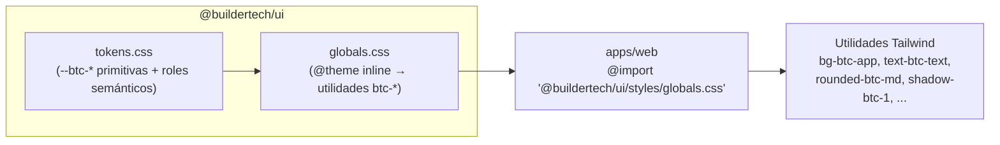

# @buildertech/ui

> **Design System propietario del monorepo BuilderTech** — Tokens, componentes, utilidades, validación y documentación en un solo paquete versionado independientemente.

[](CHANGELOG.md)
[](https://nodejs.org/)
[](https://pnpm.io/)
[](https://react.dev/)
[](https://tailwindcss.com/)

> **Nota**: Estructura reorganizada — ver [ADR-008](docs/adrs/008-reorganizacion-scaffold.md) para detalles de la migración desde `packages/ui/` a single-package root, `tests/visual/` → `e2e/visual/`, `src/scripts/` → `scripts/`, y separación de tsconfigs.

---

## 🚀 Quick Start

### Instalación desde GitHub Packages

```bash
# Configurar registry para @buildertech scope
npm config set @buildertech:registry https://npm.pkg.github.com/

# Autenticarse (requiere GITHUB_TOKEN con read:packages)
npm login --registry=https://npm.pkg.github.com/
# Username: tu-usuario-github
# Password: GITHUB_TOKEN (Personal Access Token con read:packages)

# Instalar
pnpm add @buildertech/ui
```

### Instalación desde Monorepo Local (Desarrollo)

```bash
# Desde la raíz del monorepo
pnpm add @buildertech/ui --workspace --filter=apps/web
```

### Configuración CSS (Una sola línea)

```css
/* apps/web/src/app/styles/globals.css */
@import "tailwindcss";
@import "@buildertech/ui/styles/globals.css";

/* Solo overrides mínimos si la app lo necesita */
```

### Uso de Componentes

```tsx
import { Button, Card, Dialog, Table } from '@buildertech/ui';
import { Icon } from '@buildertech/ui/lib/icon';
import { classnames } from '@buildertech/ui/lib/classnames';

export function MiComponente() {
  return (
    <Card variant="default" padding="md">
      <Card.Header>
        <Card.Title>Título</Card.Title>
      </Card.Header>
      <Card.Content>
        <Button variant="primary" size="md" iconLeft={<Icon name="plus" category="action" size="sm" />}>
          Acción principal
        </Button>
      </Card.Content>
    </Card>
  );
}
```

### Tipografías (en `layout.tsx`)

```tsx
import { getFontSans, getFontMono } from '@buildertech/ui/lib/fonts';

const interSans = getFontSans();
const jetbrainsMono = getFontMono();

export default function RootLayout({ children }) {
  return (
    <html className={`${interSans.variable} ${jetbrainsMono.variable}`}>
      <body>{children}</body>
    </html>
  );
}
```

---

## 📦 Qué Incluye

| Categoría | Detalle |
|:----------|:--------|
| **Tokens de diseño** | Variables CSS `btc-*` (colores, espaciado, radios, fuentes, sombras, movimiento) + roles semánticos light/dark |
| **23 Componentes UI** | 16 base (Button, Card, Dialog, Select, Table, NavLink, Badge, Textfield, EmptyState, LoadingState, ErrorState, ErrorPage, CopyButton, BackButton, ThemeToggle, Skeleton) + 7 primitivas nativas (DropdownMenu, Toast, Label, Separator, Slot) |
| **Utilidades** | `classnames` (clsx + tailwind-merge), `Icon` (Lucide React wrapper semántico), `fonts` helpers |
| **Validación** | `check:design` — 11 reglas visuales + grep `fetch\|supabase\|prisma\|axios` como guardarraíl anti-lógica-de-negocio |
| **Tests visuales** | Playwright: 4 anchos (360, 768, 1024, 1440) × 2 temas (light/dark) = 128 snapshots base |
| **Documentación** | Guía completa, enforcement, decisiones (ADRs), navegadores soportados, changelog |

---

## 🛠 Comandos

| Comando | Descripción |
|:--------|:------------|
| `pnpm --filter @buildertech/ui check:design` | Valida reglas visuales y ausencia de lógica de negocio |
| `pnpm --filter @buildertech/ui test` | Unit tests (renderToStaticMarkup, sin DOM) |
| `pnpm --filter @buildertech/ui test:visual` | Pruebas visuales de regresión (Playwright 4×2) |
| `pnpm --filter @buildertech/ui typecheck` | TypeScript strict check |
| `pnpm --filter @buildertech/ui lint` | ESLint v9 flat config + Prettier |
| `pnpm --filter @buildertech/ui quality:verify` | Pipeline completo: typecheck + lint + check:design + test |

---

## 🏗 Arquitectura

### Distribución por CSS (Una sola importación)



### Principios Arquitectónicos

| Principio | Descripción |
|:----------|:------------|
| **Fuente única de verdad** | Tokens, componentes, validación y docs viven en este paquete |
| **Distribución por CSS** | Consumidor importa **una sola línea**: `@import "@buildertech/ui/styles/globals.css"` |
| **Cero dependencias de UI externas** | Implementación propia de Dialog, Select, DropdownMenu, Toast, Label, Separator, Slot |
| **Cero lógica de negocio** | Componentes son **presentacionales únicamente** — reciben props, renderizan UI, emiten eventos |
| **Versionado independiente** | `0.1.x` para desarrollo, `1.0.0` para congelación |
| **Publicación workspace** | `private: true`, `workspace:*` — fuente directa, sin build a `dist` |
| **Tests sin DOM** | `renderToStaticMarkup` + aserciones de string (sin `jsdom`) |

### Estructura del Paquete (Post-Reorganización — ver [ADR-008](docs/adrs/008-reorganizacion-scaffold.md))

```
btc-002-ui/
├── src/                          # Código fuente
│   ├── index.ts                  # Barrel principal
│   ├── styles/
│   │   ├── tokens.css            # Variables CSS --btc-* (Tailwind v4 @theme)
│   │   └── globals.css           # @layer + @theme inline → utilidades btc-*
│   ├── components/               # 23 componentes (cada uno: .tsx, index.ts, .test.tsx, .stories.tsx)
│   │   ├── button/
│   │   ├── card/
│   │   ├── dialog/
│   │   ├── select/
│   │   ├── table/
│   │   ├── nav-link/
│   │   ├── badge/
│   │   ├── textfield/
│   │   ├── empty-state/
│   │   ├── loading-state/
│   │   ├── error-state/
│   │   ├── error-page/
│   │   ├── copy-button/
│   │   ├── back-button/
│   │   ├── theme-toggle/
│   │   ├── skeleton/
│   │   ├── label/
│   │   ├── separator/
│   │   ├── slot/
│   │   ├── toast/
│   │   └── dropdown-menu/
│   ├── lib/
│   │   ├── classnames.ts         # clsx + tailwind-merge (btc-*)
│   │   ├── icon.tsx              # Icon wrapper semántico (Lucide)
│   │   └── fonts.ts              # Helpers getFontSans()/getFontMono()
│   └── test/                     # Setup Vitest
│       ├── setup.ts              # Integration (jsdom) setup
│       └── setup-unit.ts         # Unit (node) setup
├── e2e/                          # Tests visuales Playwright
│   ├── visual/
│   │   ├── *.visual.spec.ts      # 22 specs (4 viewports × 2 temas)
│   │   └── snapshots/            # 3285 PNGs baseline (gitignored via .git/info/exclude)
│   └── support/
│       ├── global-setup.ts
│       ├── global-teardown.ts
│       ├── utils.ts
│       └── test-iframe.ts
├── scripts/                      # Scripts de validación y build
│   ├── register.mjs              # Loader tsx (Node --import)
│   ├── check-design.ts           # 11 reglas visuales + anti-biz-logic
│   └── check-component-contract.mjs  # Exports ↔ src ↔ dist
├── .storybook/                   # Storybook 8 config
├── docs/                         # Documentación
│   ├── adrs/                     # ADR-001 a ADR-008 + index.md
│   ├── arquitectura/
│   ├── componentes/
│   ├── gobernanza/
│   ├── guias/
│   └── tokens/
├── tsconfig.base.json            # Base + paths @/* → src/*
├── tsconfig.json                 # Typecheck-only (noEmit)
├── tsconfig.build.json           # Build → dist/ (declarations)
├── tsconfig.eslint.json          # Extiende tsconfig.json para ESLint
├── vitest.config.ts              # 2 projects: unit (node) + integration (jsdom)
├── playwright.config.ts          # 8 projects: 4 viewports × 2 temas
├── eslint.config.js              # Flat config (ignora e2e/, scripts/, dist/)
├── package.json                  # Scripts, 23 exports, deps
└── pnpm-workspace.yaml
```

---

## 📚 Documentación

| Documento | Descripción |
|:----------|:------------|
| [Arquitectura](docs/arquitectura/index.md) | Visión general, convenciones, estructura, arquitectura de estilos, componentes |
| [Especificación de API](docs/tokens/api-spec.md) | Props, variantes, tamaños, iconos, accesibilidad de los 23 componentes |
| [Guía de Migración](docs/guias/migration-guide.md) | Paso a paso para apps consumidoras (6 pasos, checklist, troubleshooting, rollback) |
| [Paleta Visual](docs/tokens/visual-palette.md) | Colores base, mapeo semántico light/dark, contraste WCAG 2.1 AA, bordes, elevación, botones |
| [Layout & Sizing](docs/tokens/layout-sizing.md) | Tokens de espaciado (base 4px) y enfoque Tailwind para layout/sizing/flexbox/grid/alignment |
| [Enforcement](docs/gobernanza/enforcement.md) | Políticas de uso, reglas obligatorias, sanciones por incumplimiento |
| [Decisiones (ADRs)](docs/adrs/) | ADR-001 a ADR-008 — decisiones arquitectónicas inmutables |
| [Índice de ADRs](docs/adrs/index.md) | Registro histórico de decisiones |
| [Navegadores Soportados](docs/componentes/supported-browsers.md) | Matriz de compatibilidad y política de soporte |
| [Changelog](CHANGELOG.md) | Historial de cambios por versión (Keep a Changelog) |
| [Cómo Añadir un Componente](docs/componentes/adding.md) | Guía paso a paso para contribuir componentes |

> **Nota**: Ver [ADR-008](docs/adrs/008-reorganizacion-scaffold.md) para contexto de la reorganización de scaffold y hallazgos pendientes (H1-H4).

---

## 🧪 Testing

### Unit Tests (Sin DOM)

```bash
pnpm run test
```

- Usan `react-dom/server` → `renderToStaticMarkup`
- Aserciones de string sobre markup generado
- Verifican clases `btc-*`, estructura HTML, props de accesibilidad
- Rápidos, deterministas, sin dependencias de `jsdom`
- **Ubicación**: `src/lib/**/*.test.tsx` (unit), `src/components/**/*.test.tsx` (integration)

### Visual Regression Tests (Playwright)

```bash
pnpm run test:visual
```

| Configuración | Detalle |
|:--------------|:--------|
| **Viewports** | 360px (mobile), 768px (tablet), 1024px (laptop), 1440px (desktop) |
| **Temas** | Light, Dark |
| **Proyectos** | 8 (4 × 2) |
| **Snapshots base** | 3285 (en `e2e/visual/snapshots/`, gitignored via `.git/info/exclude`) |
| **Umbral** | `maxDiffPixels: 0`, `maxDiffPixelRatio: 0.001`, `threshold: 0.2` |

> **Nota**: `test:visual` se ejecuta por separado (requiere Storybook local). No está incluido en `quality:verify` para evitar fallos en CI sin Storybook.
> **Estado actual**: 30 passed / 354 failed — ver [ADR-008 §Hallazgos Pendientes H4](docs/adrs/008-reorganizacion-scaffold.md#hallazgos-pendientes-no-conforme--no-verificable)

---

## ✅ Validación `check:design`

```bash
pnpm --filter @buildertech/ui check:design --scan-dirs=src,apps/web/src
```

### 11 Reglas Visuales

1. **Solo tokens `btc-*`** — No colores hardcoded, no `bg-blue-500`, etc.
2. **Solo utilidades `btc-*`** — No `rounded-md`, `shadow-lg`, usar `rounded-btc-md`, `shadow-btc-1`
3. **Espaciado base 4px** — Solo `--btc-space-*` (1,2,3,4,6,8,12,16)
4. **Radios definidos** — Solo `--btc-radius-*` (xs, sm, md, lg, xl, 2xl, full)
5. **Fuentes del sistema** — Solo `--btc-font-sans` / `--btc-font-mono`
6. **Duraciones estándar** — Solo `--btc-duration-*` (fast, base, slow)
7. **Easing estándar** — Solo `--btc-ease-standard`
8. **Sombras definidas** — Solo `--btc-shadow-*` (1-4)
9. **Z-index controlado** — Solo valores definidos en tokens
10. **Transiciones permitidas** — Solo `transition-colors`, `transition-opacity`, `transition-transform`, `transition-shadow`
11. **No `!important`** — Excepto en `globals.css` `@layer utilities`

### Guardarraíl Anti-Lógica-de-Negocio

```bash
# Grep prohibido en src/
fetch|supabase|prisma|axios
```

> **Regla de Oro**: Si el código importa `next/navigation`, `next-themes` provider, define rutas, hace `fetch`, accede a DB, o maneja estado de sesión → **NO va en `@buildertech/ui`**.

---

## 📦 Publicación (GitHub Packages)

### Flujo de Release

```bash
# 1. Cambios en main → Changeset automático
# 2. GitHub Action valida: typecheck + lint + check:design + tests + build
# 3. Changeset versiona y publica a GitHub Packages

# Release manual (workflow_dispatch):
# GitHub Actions → Publish @buildertech/ui → Run workflow
# Opciones: patch | minor | major | versión exacta (ej: 1.2.3)
```

### Configuración Requerida

| Secreto | Descripción |
|:--------|:------------|
| `GITHUB_TOKEN` | Auto-proporcionado por GitHub Actions (write:packages) |
| `NPM_TOKEN` | Para `npm publish` si se usa registry público |

### Versionado

- **0.1.x** — Desarrollo inicial (breaking changes permitidos)
- **1.0.0** — Freeze API pública, semver estricto
- **Changesets** — Gestiona versionado y changelog automático

### Ver Paquetes Publicados

```text
https://github.com/buildertech/ui-package/packages
```

---

## 🤝 Contribuyendo

Ver [CONTRIBUTING.md](CONTRIBUTING.md) para:

- Estándares de código (comillas simples, imports, compound components)
- Proceso de PR (issue → documentación → implementación → validación → review)
- Cómo añadir un componente nuevo
- Cómo proponer cambios a tokens/componentes
- Gobernanza (DS Owner aprueba cambios)

### Flujo Rápido

```bash
# 1. Crear issue con propuesta
# 2. Implementar en rama
# 3. Validar localmente
pnpm --filter @buildertech/ui quality:verify
# 4. PR → Review → Merge (DS Owner aprueba)
```

---

## 📋 Gobernanza

| Aspecto | Decisión |
|:--------|:---------|
| **Owner** | Design System Owner (aprueba cambios, igual que `decisions.md`) |
| **Proceso** | Issue → Documentación (`decisions.md`) → Implementación → `check:design` verde + Playwright pass → PR → Merge |
| **Guardarraíles** | `check:design` (paquete) + `enforcement.md` (regla no lógica de negocio en UI) |
| **Fuente de verdad** | `docs/` — estructura por categorías |
| **Changelog** | `CHANGELOG.md` raíz |

---

## 📄 Licencia

Privado — Uso exclusivo dentro del monorepo BuilderTech (`workspace:*`).

---

## 🔗 Enlaces Rápidos

- [Monorepo Root](../../README.md)
- [Apps Consumidoras](../../apps/)
- [Shared Package](../../packages/shared/)
- [Issue Tracker](../../../issues)
